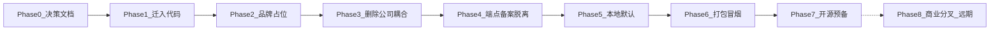

# 01 · 路线图（阶段总览）

顺序固定。前一阶段未验收，不要开始后一阶段。

| 阶段 | 产出 | 预估（有 AI、可验收） |
|------|------|----------------------|
| 0 | 本套文档 | 已完成 |
| 1 | 本仓出现可编译的源码树 | 0.5～1 天 |
| 2 | 名称/图标/builder 占位 | 0.5～1 天 |
| 3 | 删除登录计费系统模型等 | **3～7 天**（最大块） |
| 4 | 默认 API/ICP/更新/官网清洗 | 1～2 天 |
| 5 | 本地默认与首启体验 | 1～2 天 |
| 6 | 安装包熟人冒烟 | 1～3 天 |
| 7 | LICENSE/密钥扫描/开源说明 | 1～2 天 |
| 8 | 商业仓策略 | 远期，本期只文档 |

**合计到可熟人安装（完成 Phase 6）**：约 2～4 周（视 Phase 3 删除干净程度）。
