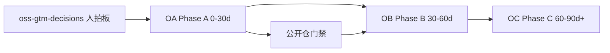

# 03 · 开源产品化 / 引流 / 商业化总览（OA → OC）

> **本线目标**：在 L2（P0～P6 / W*）可用底子之上，把产品做成**可公开的开源商品**，并预留**引流与商业壳**。  
> **本线不替代** L2 主线；公开仓库前须 L2 删除清单与微视域已清零（见 [appendix-open-source.md](appendix-open-source.md)）。  
> **状态**：计划文档已就位；**未**授权公开仓库；**未**改正式 `appId`（除非 [oss-gtm-decisions.md](oss-gtm-decisions.md) 已拍板）。

## 与 L2 的关系

| 线 | 代号 | 用途 |
|----|------|------|
| L2 本地可用 | P0～P6、W* | 熟人可装、无公司耦 |
| 开源上市 / GTM | **OA / OB / OC** | 合法公开、可传播、可商业挂钩 |
| 附录 | appendix-open-source | 公开前检查表（本线 OA 会消化其「必须完成」项） |

## 阶段一览

| 阶段 | 日历（建议） | 一句话目标 | 详档 |
|------|--------------|------------|------|
| **门禁 D** | 开工前 | 5 项产品/法律决策书面锁定 | [oss-gtm-decisions.md](oss-gtm-decisions.md) |
| **OA** | 0～30 天 | 合法公开 + 可安装可信 + 首次出结果 | [phases/OA-phase-a.md](phases/OA-phase-a.md) |
| **OB** | 30～60 天 | 可传播 + 官网回流 + 剪映故事打穿 | [phases/OB-phase-b.md](phases/OB-phase-b.md) |
| **OC** | 60～90 天+ | 商业壳边界 + 薄生态 + 信任基建 | [phases/OC-phase-c.md](phases/OC-phase-c.md) |

横切审核用语：[oss-gtm-review-rubric.md](oss-gtm-review-rubric.md)。

## 三层产品结构（全阶段遵守）

| 层 | 内容 | 硬性规则 |
|----|------|----------|
| **开源核** | 工坊 + 画布 + BYOK + 本地数据 + 剪映导出 + FFmpeg 基础 | 不得阉割逼氪；陌生人能跑通一条短剧路径 |
| **社区层** | 示例项目、模板、教程、Issue、Skills 清单 | 默认免费；可指向官网 |
| **商业壳** | 另仓/私有模块：模板订阅、支持、可选云、协作等 | 开源核**可独立编译运行**；商业能力可选加载 |

## 全局门禁（任一阶段宣称完成前）

1. **人验收**：该阶段「阶段验收」节全部勾选；AI 不得自行勾「人」项。  
2. **审核标准**：每个节点的「审核标准」必须有**可复现命令或截图证据**写入阶段「验收记录」表。  
3. **未过不得进下一阶段**；不得跳节点合并宣称「OA 完成」。  
4. **禁止**：未过门禁 D 就改正式品牌/`appId`/公开仓库；未过 OA 就宣称「已开源」。  
5. **明确不做**（全线）：完全离线大模型推理当主卖点；非官方即梦/浏览器爬桥；把公司后台/好豆塞回开源仓。

## 指挥口令

| 人说 | AI 做 |
|------|--------|
| `执行 OA` / `执行 OA1` | 读 `AGENT.md` + 本总览 + 对应阶段档，只做该范围 |
| `OA1 验收` | 按该节点「审核标准」跑命令/列证据，判通过/不通过 |
| `OA 阶段验收` | 跑阶段验收清单，未全过则列出缺口 |
| `执行 OB` / `OC…` | 同上；**须**上一阶段阶段验收已通过（人确认） |

## 工作量粗估

| 阶段 | 日历 | 卡点 |
|------|------|------|
| D | 0.5 天（人） | 许可证与品牌争执 |
| OA | 2～4 周 | 向导 UX、残留清零、更新源真机 |
| OB | 2～4 周 | 示例项目质量、官网与内容 |
| OC | 持续 | 商业边界与第一付费切口验证 |

## 下一步

1. 人填写并锁定 [oss-gtm-decisions.md](oss-gtm-decisions.md)。  
2. 人说：**执行 OA1**（或「执行 OA」按节点顺序做完再统一验收）。
