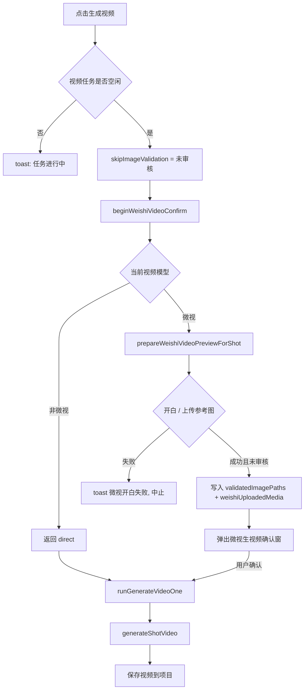

# 分镜图审核与微视开白（生视频前置）

本文档描述 Step 4 分镜工作台中，**分镜图人工/自动审核**、**微视 API 开白**与**生视频**之间的业务关系与代码入口。

---

## 1. 业务目标

- 分镜图在用于生视频前，需明确是否「已审核」。
- 使用**微视 API 视频模型**时，参考图需先上传至 `/v1/assets` 完成开白，生视频时以 `asset://` 引用，避免重复上传。
- **未审核**分镜也可直接点「生成视频」：不再弹出「分镜图尚未审核，是否继续？」确认框；系统按模型类型自动处理（微视走开白，失败则中止）。

---

## 2. 数据模型

分镜 `WorkflowShot` 上与审核相关的字段（见 `src/types/workflow.ts`）：

| 字段 | 说明 |
|------|------|
| `validatedImagePaths` | 已审核通过的分镜图路径列表（按路径粒度，切换主图后仍可按当前图判断） |
| `validatedImagePath` | 兼容旧数据的单路径字段 |
| `validated` | 兼容旧数据的布尔标记 |
| `weishiUploadedMedia` | 本地图路径 ↔ 微视 `asset://` 的缓存，生视频/开白复用 |

判断函数（`src/lib/workflow/shot-video-utils.ts`）：

- `isShotImagePathValidated(shot, imagePath?)` — 指定路径是否已审核
- `isStoryboardImageValidated(shot)` — **当前主分镜图**是否已审核
- `buildShotImageValidationPatch(shot, imagePath?)` — 将某张图标记为已审核
- `assertStoryboardImageValidated(shot)` — 未审核则抛错（生视频服务内校验，可通过 `skipImageValidation` 跳过）

---

## 3. UI 状态标识

组件：`src/components/workshop/storyboard-image-review-badge.tsx`  
缩略图：`src/components/workshop/storyboard-shot-gallery.tsx`

| 状态 | 文案 | 颜色 | 条件 |
|------|------|------|------|
| 审核通过 | 分镜图审核通过 | **绿色** | 当前主图路径 ∈ `validatedImagePaths` |
| 待审核 | 分镜图待审核 | **黄色** | 已有分镜图但未审核 |
| 生成失败 | 生成失败 | **红色** | `shot.status === 'failed'` |
| 生成中 | 分镜图生成中 | 黄色闪烁 | `shot.status === 'generating'` |

右侧「生成的图片」缩略图：每张图按路径独立显示绿/黄/红角标；主图选中仍为青色描边。

---

## 4. 审核的两种方式

### 4.1 手动审核（「审核分镜图」按钮）

入口：`step4-storyboard-page.tsx` → `handleValidateShot`  
服务：`src/lib/workflow/shot-storyboard-review-service.ts` → `syncShotStoryboardToWeishiReview`

流程：

1. 校验当前视频模型为**微视 API**（否则 toast 报错）。
2. 取当前主分镜图路径；无图则报错。
3. 若 `weishiUploadedMedia` 已有该路径的 `asset://` 缓存 → 直接写入审核 patch。
4. 否则上传至微视 `/v1/assets`，轮询直至 `active/ready`。
5. **开白成功** → 合并写入：
   - `buildShotImageValidationPatch`（审核通过）
   - `weishiUploadedMedia`（asset 缓存）
6. **开白失败** → 抛错，toast 提示，状态不变。

### 4.2 生视频时自动审核（微视开白）

未审核分镜点击「生成视频」时，不再二次确认，直接进入生视频流程；微视模型会在上传参考素材时同步开白，并在成功后**自动标记当前分镜图为审核通过**。

---

## 5. 单个分镜生视频流程

入口：`requestGenerateVideoOne`（`step4-storyboard-page.tsx`）

要点：

| 步骤 | 行为 |
|------|------|
| 未审核拦截弹窗 | **已移除**（原「分镜图尚未审核，是否仍要生成？」） |
| `skipImageValidation` | 未审核时为 `true`，跳过 `assertStoryboardImageValidated` |
| 微视 + 未审核 | `markStoryboardValidated: true`，开白成功后调用 `buildShotImageValidationPatch` |
| 微视开白失败 | 返回 `failed`，**不**调用生视频 API |
| 非微视 | `beginWeishiVideoConfirm` 返回 `direct`，直接 `runGenerateVideoOne` |

核心代码：

- 页面编排：`src/pages/workshop/step4-storyboard-page.tsx`
- 微视预览与上传：`src/lib/models/weishi-video-client.ts` → `prepareWeishiVideoRequestPreview` / `collectWeishiReferences`
- 开白上传单图：`uploadWeishiAssetReferenceUrl`（未就绪则抛「微视开白处理中，请稍后再试」）
- 持久化：`src/lib/models/weishi-shot-media-cache.ts` → `buildWeishiUploadPersistPatches`
- 生视频：`src/lib/workflow/shot-video-service.ts` → `generateShotVideo`

---

## 6. 批量生视频流程

入口：`handleBatchGenerateVideos`

与单镜差异：

- **不再**过滤未审核分镜，范围内有 Prompt 的分镜均可进入批量。
- 首个分镜走 `beginWeishiVideoConfirm`（微视时展示确认窗）；其余分镜在 `runBatchGenerateVideos` 中并发执行。
- 每个分镜独立设置 `skipImageValidation = !isStoryboardImageValidated(shot)`。
- 批量中微视上传回写时，若该镜未审核，在 `onWeishiPersist` 中合并 `buildShotImageValidationPatch`。

---

## 7. 微视开白 API 约定

- 上传/审核：`POST /v1/assets`（`uploadWeishiReviewAsset`）
- 轮询：`pollWeishiReviewAsset`，最多 20 次 × 3s
- 就绪状态：`isWeishiAssetReady`（如 `active` / `ready`）
- 生视频：`POST /v1/videos`，参考图使用 `asset://` URL

模型配置（设置 → 视频模型 → 微视 API）：

- `weishiAssetWhitelistEnabled`：开启后优先走 assets 开白（与参考图上传策略相关）
- 需配置 `endpoint`、`apiKey`

---

## 8. 错误与用户提示

| 场景 | 用户可见结果 |
|------|----------------|
| 微视开白失败 | toast「微视开白失败」或具体错误文案，不生视频 |
| 开白轮询超时 | 「微视开白处理中，请稍后再试」 |
| 非微视点「审核分镜图」 | 「非微视API视频模型暂不支持审核」 |
| 无分镜图点审核 | 「请先生成分镜图后再审核」 |
| 视频任务进行中 | 「视频任务进行中，请稍候」 |

---

## 9. 相关文件索引

| 职责 | 路径 |
|------|------|
| Step4 页面编排、生视频入口 | `src/pages/workshop/step4-storyboard-page.tsx` |
| 手动审核服务 | `src/lib/workflow/shot-storyboard-review-service.ts` |
| 审核状态工具 | `src/lib/workflow/shot-video-utils.ts` |
| 生视频服务 | `src/lib/workflow/shot-video-service.ts` |
| 微视上传/开白/生视频 | `src/lib/models/weishi-video-client.ts` |
| 微视 asset 缓存双写 | `src/lib/models/weishi-shot-media-cache.ts` |
| 审核徽章 UI | `src/components/workshop/storyboard-image-review-badge.tsx` |
| 分镜图缩略图角标 | `src/components/workshop/storyboard-shot-gallery.tsx` |
| 微视生视频确认弹窗 | `src/components/workshop/weishi-video-confirm-dialog.tsx` |

---

## 10. 历史变更说明

- **已删除**：未审核分镜生视频前的 `ConfirmDialog`（「分镜图尚未审核…是否仍要生成？」）。
- **新增**：微视生视频前开白成功 → 自动写入 `validatedImagePaths`（等同审核通过）。
- **新增**：微视开白失败 → 中止流程，不调用生视频接口。

---

## 11. 自测建议

1. 未审核分镜 + 微视模型：点「生成视频」→ 无二次确认 → 开白成功 → 状态变绿 → 确认窗 → 视频生成。
2. 开白失败（错误 Key/网络）：应报错且不生视频。
3. 已审核分镜：点「生成视频」→ 复用已有 `asset://`，不再重复开白主图。
4. 手动「审核分镜图」：与自动开白写入字段一致，UI 显示绿色。
5. 批量生视频：范围内含未审核分镜，应逐个尝试开白并生视频，不整批跳过。
